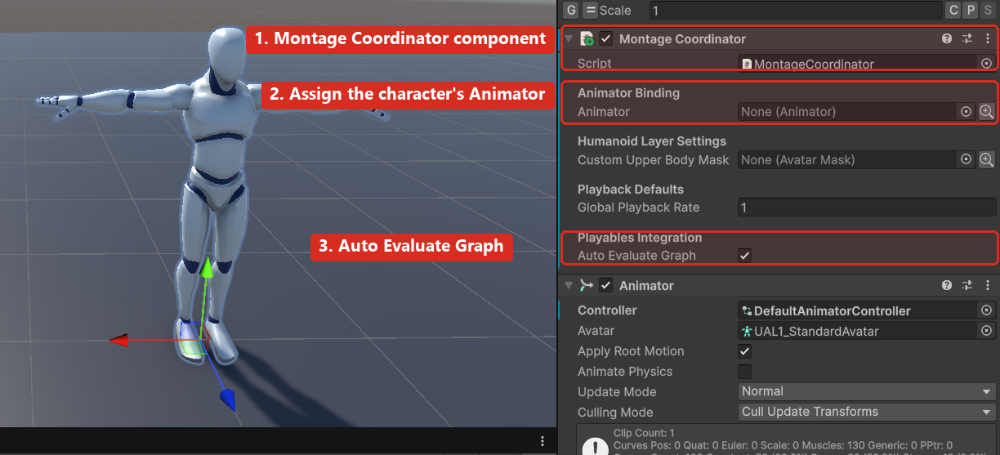
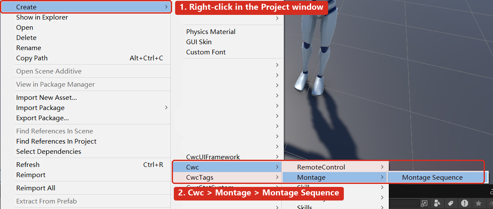
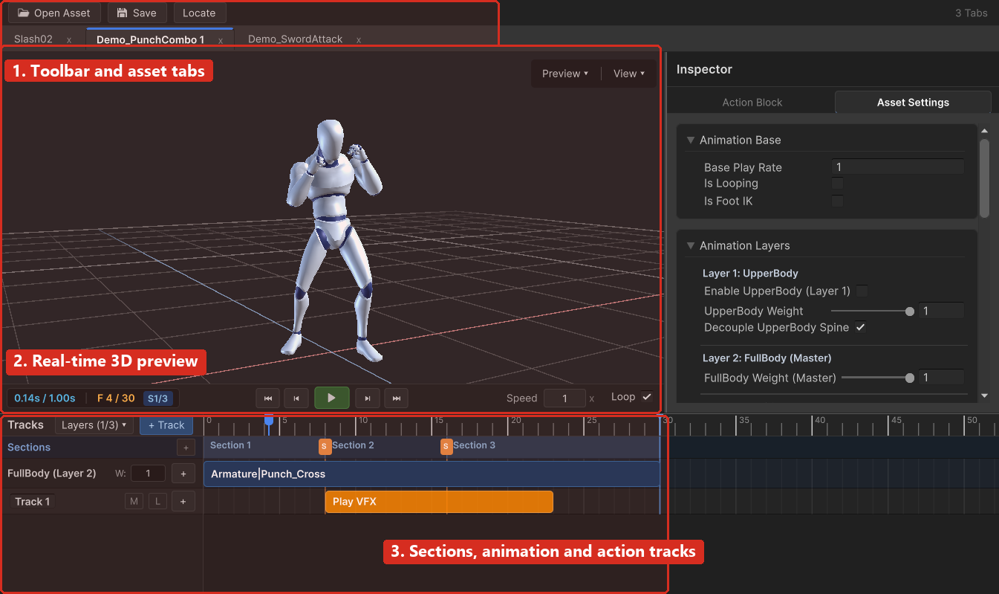
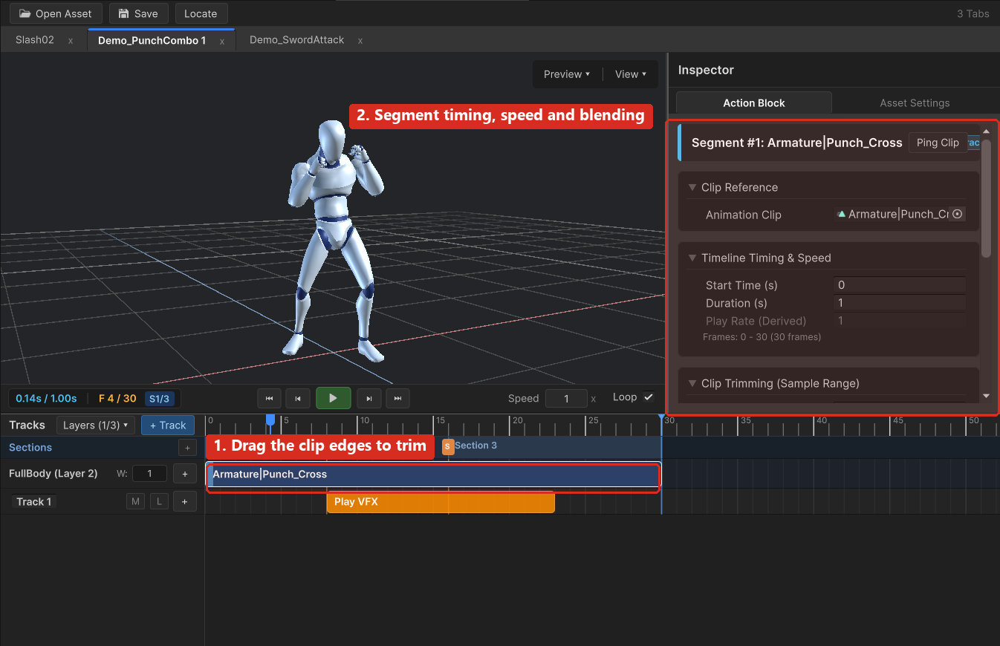
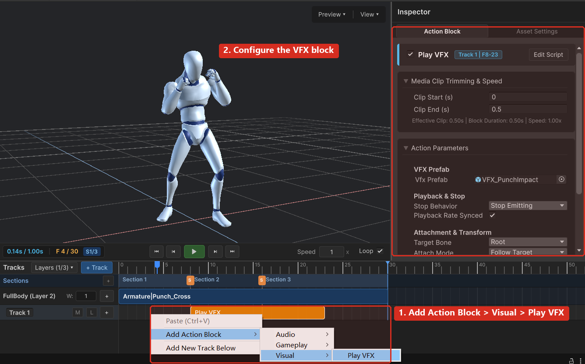
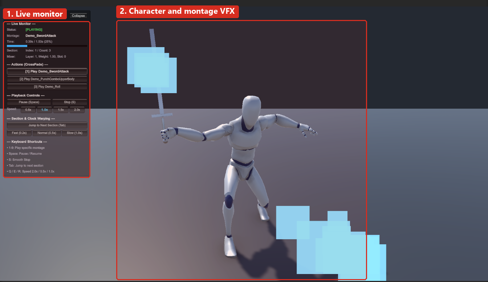

# 1. Introduction

## 1.1 What CwcMontage Does

CwcMontage is a presentation-layer animation montage system for Unity. It plays scripted action animations - attacks, rolls, casts, hit reactions - on top of your existing locomotion Animator Controller, with precise control over when each part of the action plays.

It is built on Unity's Playables API and takes care of four jobs:

- **Playback**: play one or more animation clips as a single timed sequence, with blending into and out of the current pose.
- **Layering**: mix full-body, upper-body and additive animation on one character at the same time.
- **Timing**: divide a montage into sections, jump between them, and stretch a section to a duration required by gameplay.
- **Presentation events**: trigger audio, VFX and prefab spawns at exact times inside the action, and route root motion deltas to your own movement code.

CwcMontage does not contain combat logic. Damage, hit detection, cooldowns, input buffering and state machines stay in your gameplay code. The package only answers the question: "what should this character look like, and what should it emit, between time A and time B?"

## 1.2 How It Fits Into a Project

A typical call chain looks like this:

1. Your ability or state machine decides that an attack starts.
2. It calls `coordinator.Play(attackMontage)`, which returns a `MontageHandle`.
3. CwcMontage crossfades from locomotion into the montage, fires action blocks (audio, VFX), and reports section changes.
4. When the montage ends, is interrupted or is stopped, control blends back to the locomotion controller.
5. If root motion is enabled, your `IMontageRootMotionReceiver` implementation moves the character.

You keep ownership of movement, damage and state. CwcMontage owns the animation graph.

## 1.3 Requirements

| Item | Requirement |
| :--- | :--- |
| Unity version | 2021.3 LTS or newer |
| Render pipeline | Built-in, URP or HDRP. CwcMontage itself is pipeline-agnostic; the demo particles use URP materials (see section 9) |
| Rig type | Humanoid (recommended) or Generic |
| Animator | One `Animator` component with an assigned `Avatar` for Humanoid rigs |
| Scripting | .NET Standard 2.1 / C# 9 (default for Unity 2021.3) |

> **Note:** CwcMontage expects to own the character's PlayableGraph. If another package also builds a graph on the same Animator, use a single integration point instead of two independent graphs.

# 2. Installation

## 2.1 Import From the Asset Store

1. Open **Window > Package Manager** and select the **My Assets** tab.
2. Search for **CwcMontage**, click **Download**, then **Import**.
3. Wait for the import to finish and confirm that no console errors appear.

## 2.2 Import From a Folder or .unitypackage

1. Locate the `CwcMontage` folder inside the downloaded package.
2. Copy it into your project's `Assets` folder, for example `Assets/CwcPlugins/CwcMontage`.
3. Wait for Unity to compile, then confirm that no console errors appear.

> **Note:** Do not copy the folder into `Assets/Plugins`. The package ships its own assembly definitions and must compile as a normal asset folder.

## 2.3 Upgrade and Uninstall

- **Upgrade**: close all Montage Editor windows, replace the folder, and reopen the project. Existing `MontageSequenceSO` assets keep their GUIDs.
- **Uninstall**: delete the `CwcMontage` folder. Remove any `MontageCoordinator` components left on prefabs and scenes; Unity reports missing scripts otherwise.

## 2.4 Package Structure

| Folder | Contents |
| :--- | :--- |
| `Runtime/Core` | `MontageSequenceSO`, `MontageAnimationSegment`, action block base classes, attributes |
| `Runtime/Engine` | `MontageCoordinator`, `MontagePlayer`, `MontageHandle`, Playables dispatcher |
| `Runtime/Blocks` | Built-in action blocks: audio, VFX, prefab spawn |
| `Runtime/Pool` | Object pool and typed block state pool |
| `Runtime/Utility` | Bone resolution, AvatarMask helpers, spine decoupling utility |
| `Runtime/Resources` | `Dummy.prefab`, a lightweight skeleton used for procedural sampling |
| `Editor/UI` | UI Toolkit timeline editor elements |
| `Editor/Core` | Asset opener, clipboard, custom inspectors |
| `Editor/Styles` | USS stylesheet for the editor window |
| `Documentation` | This manual (PDF and Markdown) and its images |
| `Demo` | Playable demo scene, sample montages, character, VFX prefabs |

# 3. Quick Start

This section builds a working attack montage from an empty scene in about five minutes.

## Step 1 - Attach the Montage Coordinator

1. Select the character GameObject that holds the `Animator` component.
2. Click **Add Component** and search for **Montage Coordinator**, or use **Cwcbb > Montage > Montage Coordinator**.
3. In the Inspector, set **Animator** to the character's `Animator`. If you leave it empty, the component searches itself and its direct children.



> **Tip:** Keep **Auto Evaluate Graph** enabled unless another system evaluates the PlayableGraph for you.

## Step 2 - Create a Montage Sequence Asset

1. In the Project window, open the folder where the montage should live, for example `Assets/Animations/Montages`.
2. Right-click and choose **Create > Cwc > Montage > Montage Sequence**.
3. Name the asset, for example `Montage_LightAttack_01`.



A montage asset stores animation segments, section split points, track layout and action blocks. It is a `ScriptableObject`, so several characters can share one montage.

## Step 3 - Open the Timeline Editor

1. Double-click the new asset, or
2. Open **Window > Cwc > Montage Editor** and drag the asset onto the tab bar.



## Step 4 - Add Animation Clips and Action Blocks

1. Drag an `AnimationClip` from the Project window onto the **FullBody** track.
2. Drag the clip edges to trim it, or drag the whole segment to move it in time.
3. Select the segment to edit its blend-in and blend-out times in the Inspector.
4. Right-click an action track and choose **Add Action Block > Visual > Play VFX** or **Audio > Play Audio**.
5. Click **Save** in the toolbar to write the changes into the asset.





> **Note:** The editor supports Undo/Redo. Unsaved changes are marked with an asterisk on the tab; closing a modified tab asks for confirmation.

## Step 5 - Play the Montage From Code

Add a small component to your character:

```csharp
using UnityEngine;
using Cwcbb.Tools.CwcMontage;

public class PlayerCombat : MonoBehaviour
{
    [SerializeField] private MontageCoordinator _coordinator;
    [SerializeField] private MontageSequenceSO _attackMontage;

    private void Update()
    {
        if (Input.GetMouseButtonDown(0))
        {
            MontageHandle handle = _coordinator.Play(_attackMontage);
            if (!handle.IsValid)
            {
                Debug.LogWarning("The montage could not be played.");
                return;
            }

            Debug.Log($"Attack started, duration {handle.TotalDuration:0.00} s.");
        }
    }
}
```

Enter Play Mode, press the left mouse button, and the character plays the attack once and blends back to locomotion. To react when the montage ends, subscribe to `MontageCoordinator.OnMontageEnded` (see section 5.5).

# 4. Timeline Editor Reference

## 4.1 Window Layout

The editor window contains four areas:

- **Toolbar**: play, pause, step one frame, loop, speed, current time and frame rate.
- **Time ruler**: seconds and frames, with a draggable playhead.
- **Tracks**: the `Sections` bar, three animation tracks (`UpperBody`, `FullBody`, `Additive`) and user action tracks.
- **Inspector**: settings for the selected segment or action block, plus the asset-wide settings tab.

Keyboard shortcuts: `Space` play/pause, `,` / `.` step one frame, `Home` / `End` first/last frame, `Ctrl+S` save, `Ctrl+C` / `Ctrl+V` / `Ctrl+D` copy, paste and duplicate, `Delete` remove the selected segment, block or track.

## 4.2 Tracks

| Track | Purpose | Typical use |
| :--- | :--- | :--- |
| UpperBody | Replaces the upper body while locomotion keeps playing | Aiming, casting, shooting while running |
| FullBody | Replaces the whole body | Rolls, heavy attacks, executions |
| Additive | Adds a delta pose on top of everything | Flinch, recoil, breathing |
| Action tracks | Named containers for action blocks | Audio, VFX, gameplay events |

Each animation track holds one or more segments. Segments may overlap; CwcMontage crossfades between them using each segment's blend-in and blend-out envelope.

## 4.3 Trimming, Scrubbing and Snapping

- **Scrub**: drag anywhere on the ruler, or drag the playhead.
- **Trim**: drag the left or right edge of a segment or of a trimmable block.
- **Move**: drag the body of a segment.
- **Snap**: enable snapping in the toolbar to align to whole frames, the playhead, section boundaries and neighbouring clip edges.

The viewport previews the result immediately, including particle systems, which are simulated forward and backward to the current scrub time.

## 4.4 Sections

Sections divide the montage into named phases - for example anticipation, active hitbox and recovery.

- Click the `+` button on the `Sections` bar to add a split point at the playhead, or double-click an empty spot on the bar to add one at that time.
- Drag a split marker to move it; right-click a marker to delete it.
- The Inspector shows the index, start time and duration of each section.

Sections are purely geometric: they do not contain logic, so gameplay decides what a section means. Section indices start at 0.

## 4.5 3D Preview

The right side of the window contains an isolated preview viewport:

- **Preview menu**: choose the preview model, the locomotion preview clip and an optional `AvatarMask`.
- **View menu**: toggle root motion preview, foot IK, grid, shading and gizmos.

By default the editor reuses the last previewed humanoid model, so a new montage can be inspected without configuring anything.

## 4.6 Clipboard and Multi-Asset Editing

- `Ctrl+C` / `Ctrl+V` copy action blocks and tracks between montage assets.
- Several assets can be open at once; each gets its own tab.
- Selecting a different asset in the Project window does not close the current tab.

# 5. Runtime Workflows

## 5.1 Layers

`MontageCoordinator` builds one PlayableGraph with four inputs:

| Input | Content |
| :--- | :--- |
| 0 | Your locomotion `RuntimeAnimatorController` |
| 1 | UpperBody montage layer |
| 2 | FullBody montage layer |
| 3 | Additive montage layer |

`MontageLayerChannel` selects the layer:

```csharp
MontageHandle upper = _coordinator.Play(castMontage, customBlendInTime: 0.1f);
```

The montage asset decides which layer it plays on through its tracks and weights. Each layer keeps two pre-allocated slots and ping-pongs between them, so playing a second montage on the same layer crossfades instead of rebuilding the graph.

Layer weights can be adjusted at runtime:

```csharp
_coordinator.SetLayerWeight(1, 0.4f);   // FullBody at 40%
_coordinator.SetChannelWeight(MontageLayerChannel.Additive, 0.8f);
```

## 5.2 Sections and Time Warping

Gameplay timing rarely matches animation timing. A windup that takes 0.6 s in the clip may need to take 0.25 s at runtime.

```csharp
MontageHandle handle = _coordinator.Play(attackMontage);

// Stretch or compress a section to an exact duration.
handle.SyncSectionDuration(0, 0.25f);

// Jump to the start of a section.
handle.JumpToSection(1);

// Jump to an absolute time in seconds.
handle.JumpToTime(0.8f);

// Drive a section from an external value, for example charge time.
handle.EvaluateSectionProgress(1, chargePercent);

// Read what the montage is doing.
int section = handle.CurrentSectionIndex;
float progress = handle.GetSectionProgress(section);
```

Time warping changes only the runtime clock; the asset and the clip are never modified.

## 5.3 Root Motion

CwcMontage does not move the Transform. It extracts root motion deltas and forwards them, so your movement code remains authoritative.

Option A - implement the interface on your movement component:

```csharp
using UnityEngine;
using Cwcbb.Tools.CwcMontage;

public class CharacterMovement : MonoBehaviour, IMontageRootMotionReceiver
{
    [SerializeField] private CharacterController _controller;

    public void OnMontageRootMotionDisplacement(Vector3 deltaPosition)
    {
        _controller.Move(deltaPosition);
    }

    public void OnMontageRootMotionRotation(Quaternion deltaRotation)
    {
        transform.rotation *= deltaRotation;
    }
}
```

Option B - subscribe to the coordinator event:

```csharp
_coordinator.OnRootMotionDelta += (deltaPosition, deltaRotation) =>
{
    _controller.Move(deltaPosition);
    transform.rotation *= deltaRotation;
};
```

Root motion axes are filtered per montage asset: **Apply Horizontal**, **Apply Vertical** and **Apply Rotation**.

> **Note:** If the character's Animator has **Apply Root Motion** enabled, disable it while using CwcMontage, otherwise two systems move the character at the same time.

## 5.4 Upper-Body Spine Decoupling

When a humanoid runs, pelvis rotation twists the whole upper body. An attack aimed forward therefore drifts with the legs.

With **Decouple Upper Body Orientation** enabled on the montage asset, CwcMontage samples a lightweight dummy skeleton, computes the spine's rotation relative to the root, and counter-rotates the spine in `LateUpdate`.

- Works with standard humanoid rigs without changing the model.
- Disabled automatically when the asset provides a custom `AvatarMask`.
- Has a small per-frame cost; disable it for montages that do not need it.

## 5.5 Playback Control

```csharp
MontageHandle handle = _coordinator.Play(montage);

handle.SetPlaybackRate(1.5f);   // fast forward
handle.SetPaused(true);         // freeze
handle.SetWeight(0.5f);         // fade the montage down
handle.Stop(0.2f);              // fade out over 0.2 s and release the slot
```

Coordinator-level helpers:

```csharp
_coordinator.StopChannel(MontageLayerChannel.FullBody, 0.15f);
_coordinator.StopLayer(2, 0.15f);
_coordinator.StopAll(0.15f);
bool busy = _coordinator.IsPlayingAnyMontage;
MontageHandle active = _coordinator.GetActiveHandle(MontageLayerChannel.UpperBody);
```

Events: `OnMontageStarted`, `OnMontageEnded`, `OnSectionChanged` and `OnRootMotionDelta`.

# 6. Built-in Action Blocks

Action blocks are small serializable objects placed on action tracks. Each block has a start time and a duration; CwcMontage calls them in order and guarantees that `OnEnter` and `OnExit` are paired even if the frame rate collapses.

## 6.1 AudioActionBlock

Plays a sound at a point in the montage.

| Field | Description |
| :--- | :--- |
| Audio Clip | Base clip |
| Random Audio Clips | Optional pool; one clip is chosen at random per play |
| Volume / Pitch | Base playback parameters |
| Random Pitch Offset | Randomises pitch within +/- the offset |
| Spatial Blend | 0 = 2D, 1 = fully 3D |
| Min / Max Distance | 3D attenuation range |
| Play Mode | `OneShot` or `LoopDuringBlock` |
| Fade Out On Exit | Fades the sound when the block ends or is interrupted |
| Fade Out Duration | Fade length in seconds |
| Target Bone | Bone used as the 3D audio position |

## 6.2 VFXActionBlock

Spawns and recycles a particle prefab.

| Field | Description |
| :--- | :--- |
| VFX Prefab | Prefab containing one or more `ParticleSystem` components |
| Stop Behavior | `StopEmitting` lets existing particles finish; `ClearImmediately` clears them |
| Playback Rate Synced | Particle simulation speed follows montage playback rate |
| Clip Start / End | Trims the particle timeline to a sub-range |
| Target Bone / Attach Mode | Attachment point and tracking mode |
| Position / Rotation Offset | Local offset relative to the bone |
| Scale | Local scale multiplier |

## 6.3 PrefabSpawnActionBlock

Spawns a generic prefab - a weapon, a decal, a temporary collider.

| Field | Description |
| :--- | :--- |
| Prefab | Prefab to instantiate |
| Lifecycle | `RecycleOnBlockExit`, `CustomDuration` or `Independent` |
| Custom Duration | Lifetime in seconds when `CustomDuration` is selected |

## 6.4 Shared Spatial Settings

Audio and VFX blocks derive from `MontageSpatialActionBlockBase`, so they share:

| Setting | Values |
| :--- | :--- |
| Target Bone | `Root`, `Hips`, `Spine`, `Head`, `RightHand`, `LeftHand`, `RightFoot`, `LeftFoot` |
| Attach Mode | `FollowTarget`, `FollowPositionOnly`, `WorldPositionAtStart` |

## 6.5 Adding Blocks in the Editor

1. Right-click an action track (or an empty area below the tracks).
2. Choose **Add Action Block**, then a category and a block type.
3. Select the block and edit its fields in the Inspector.
4. Drag the block edges to change its time range.

# 7. Custom Action Blocks

## 7.1 A Stateless Block

Use a stateless block for one-shot effects that need no per-character memory.

```csharp
using System;
using UnityEngine;
using Cwcbb.Tools.CwcMontage;

[Serializable]
[MontageCategory("Combat")]
[MontageDisplayName("Camera Shake")]
[MontageColor("#E74C3C")]
public class CameraShakeActionBlock : MontageActionBlockBase
{
    [SerializeField] private float _intensity = 1.0f;
    [SerializeField] private float _duration = 0.15f;

    public override void OnEnter(in MontageActionContext context)
    {
        base.OnEnter(context);
        CameraShake.Play(_intensity, _duration);
    }
}
```

`MontageActionContext` exposes the owning coordinator, the target `GameObject` and the current montage state, so a block never needs to cache references itself.

## 7.2 A Stateful Block (No Allocations)

When a block must remember something per character - for example "this hitbox already damaged this target" - derive from `MontageActionBlockBase<TState>`. The state object lives in a pool and is reused.

```csharp
using System;
using UnityEngine;
using Cwcbb.Tools.CwcMontage;

[Serializable]
[MontageCategory("Combat")]
[MontageDisplayName("Melee Hitbox")]
[MontageColor("#C0392B")]
public class MeleeHitboxActionBlock : MontageActionBlockBase<MeleeHitboxActionBlock.HitboxState>
{
    public class HitboxState : IMontageBlockState
    {
        public bool HasHitTarget;

        public void Reset()
        {
            HasHitTarget = false;
        }
    }

    [SerializeField] private float _damage = 25f;

    protected override void OnEnter(in MontageActionContext context, HitboxState state)
    {
        state.HasHitTarget = false;
        // Enable the weapon hitbox for this character, for example:
        // context.TargetObject.GetComponent<MeleeWeapon>().EnableHitbox(_damage);
    }

    protected override void OnUpdate(in MontageActionContext context, HitboxState state, float deltaTime)
    {
        if (!state.HasHitTarget && TryDetectTarget(context, out var target))
        {
            state.HasHitTarget = true;
            ApplyDamage(target);
        }
    }

    protected override void OnExit(in MontageActionContext context, HitboxState state)
    {
        // Disable the hitbox again. This is always called, even if the montage is interrupted.
        // context.TargetObject.GetComponent<MeleeWeapon>().DisableHitbox();
    }

    private bool TryDetectTarget(in MontageActionContext context, out GameObject target)
    {
        target = null;
        return false; // Replace with an overlap query in your project.
    }

    private void ApplyDamage(GameObject target)
    {
        // Replace with your damage system.
    }
}
```

Rules for state classes:

- Implement `IMontageBlockState` and `Reset()`.
- Keep the class parameterless-constructible (`new()` constraint).
- Do not store scene references permanently; they are cleared when the state returns to the pool.

## 7.3 Registering a Custom Block

1. Put the script in an assembly that references `Cwcbb.Tools.CwcMontage.Runtime`.
2. Add `[MontageCategory]`, `[MontageDisplayName]` and optionally `[MontageColor]`.
3. Recompile; the block appears under **Add Action Block** in the editor.

# 8. API Reference

## 8.1 MontageCoordinator

| Member | Description |
| :--- | :--- |
| `Play(MontageSequenceSO montage, float? customBlendInTime, AnimationCurve customBlendInCurve)` | Starts a montage and returns its handle |
| `GetActiveHandle(MontageLayerChannel)` / `GetActiveHandle(int layerIndex)` | Handle of the montage currently active on a layer |
| `StopChannel(...)`, `StopLayer(...)`, `StopAll(float blendOutTime)` | Fade out and release layers |
| `IsPlayingChannel(...)`, `IsPlayingLayer(...)`, `IsPlayingAnyMontage` | Playback queries |
| `SetLayerWeight` / `GetLayerWeight`, `SetChannelWeight` / `GetChannelWeight` | Layer weight control |
| `SetLocomotionAnimatorController`, `SetLocomotionPlayable`, `ResetLocomotionAnimatorController` | Replace the locomotion input |
| `TargetAnimator`, `GlobalPlaybackRate`, `AutoEvaluateGraph` | Configuration |
| `GetTargetBone(MontageTargetBone)` | Resolve a humanoid bone transform |

## 8.2 MontageHandle

| Member | Description |
| :--- | :--- |
| `IsValid`, `IsPlaying`, `IsStopping`, `IsFinished`, `IsPaused` | State queries; a recycled slot invalidates old handles |
| `CurrentWeight`, `TotalDuration`, `ElapsedTime`, `RemainingTime` | Playback values |
| `NormalizedTime`, `Progress` | Normalised progress in [0, 1] |
| `CurrentSectionIndex`, `SectionCount` | Section state |
| `JumpToSection(int)`, `JumpToTime(float)` | Immediate jumps |
| `SyncSectionDuration(int, float)` / `SyncSection(...)`, `ClearSectionSync(int)` | Time warping |
| `EvaluateSectionProgress(int, float)`, `GetSectionProgress(int)`, `GetSectionDuration(int)` | External progress driving |
| `SetPlaybackRate(float)`, `SetWeight(float)`, `SetPaused(bool)`, `Stop(float?)` | Playback control |

Completion and interruption are reported by `MontageCoordinator.OnMontageEnded` (the argument is the affected handle), or polled through `IsFinished` and `IsPlaying`. The handle does not own events, because it is a short-lived value type that can be invalidated when its slot is recycled.

`MontageHandle` is a readonly struct. Store it only while the montage is alive; after the slot is recycled, `IsValid` becomes false and further calls are ignored safely.

## 8.3 MontageSequenceSO

| Member | Description |
| :--- | :--- |
| `UpperBodySegments`, `FullBodySegments`, `AdditiveSegments` | Segment lists per track |
| `Tracks` | Action tracks and their blocks |
| `SectionCount`, `SplitTimestamps` | Section layout |
| `TotalDuration`, `NaturalEndTime`, `TotalFrames` | Timing |
| `DefaultBlendInTime`, `DefaultBlendOutTime`, `BlendInCurve`, `BlendOutCurve`, `BlendOutOffset` | Blend defaults |
| `ApplyHorizontalRootMotion`, `ApplyVerticalRootMotion`, `ApplyRotationRootMotion` | Root motion filters |

# 9. Demo Scene

Open `Demo/Scenes/MontageDemoScene.unity` and press Play.



| Input | Action |
| :--- | :--- |
| `1` - `9` | Play one of the sample montages |
| `Space` | Pause or resume |
| `S` | Smooth stop |
| `Tab` | Jump to the next section |
| `Q` / `E` / `R` | Fast (2.0x) / slow (0.5x) / normal (1.0x) |

The overlay shows the active montage, layer, slot, weight, section index and progress. The demo is self-contained and does not modify your project settings.

> **Note:** The demo's particle materials use URP shaders. In a Built-in Render Pipeline project they appear magenta. This affects only the demo assets; the runtime assembly and your own montages are unaffected. Install the Universal RP package or replace the two demo materials if you want the demo to look correct in Built-in.

# 10. Troubleshooting

**The character does not animate when I call `Play`.**
Check that the `Animator` has an `Avatar` assigned, that `TargetAnimator` points to it, and that the montage asset has at least one segment with a clip. Open the console: CwcMontage logs the reason when it rejects a play request.

**The montage plays, but the character keeps sliding.**
Root motion is enabled both on the Animator and in code. Disable **Apply Root Motion** on the Animator and apply the deltas through `IMontageRootMotionReceiver` or `OnRootMotionDelta`.

**Upper-body actions do not blend over locomotion.**
Enable the upper-body track on the montage asset, make sure the character is Humanoid, and check the layer weight. A custom `AvatarMask` disables the procedural spine decoupling by design.

**Generic rigs behave differently.**
Generic characters have no humanoid bone mapping. Use the `FullBody` track only, and attach VFX or audio to `Root`.

**Section indices do not match what I see in the editor.**
Sections are zero-based and always cover the whole montage: `SectionCount` equals the number of split points plus one.

**Audio plays twice.**
An audio block is usually triggered once per montage play. If you also play the sound from gameplay code, remove one of the two sources.

**The demo VFX are magenta or invisible.**
See the note at the end of section 9.

**The editor window shows a skeleton instead of my character.**
Set the preview model in the **Preview** menu, or enable **Asset Override** on the montage asset to bind a model to that asset only.

# 11. Version History and Support

| Version | Highlights |
| :--- | :--- |
| 1.2.2 | Asset-level preview model override, custom upper-body `AvatarMask`, skeleton mismatch warnings, compact viewport toolbar |
| 1.2.1 | Virtual hooks for subclassing, Playables integration points for third-party pipelines |
| 1.2.0 | 0-GC runtime state separation, typed block state pool, player pool, baked immutable blocks |
| 1.1.0 | Multi-layer channels, spine decoupling, per-segment blend envelopes, global dummy skeleton |
| 1.0.0 | Playables montage core, dual-slot crossfade, section time warping, root motion delegation, timeline editor |

**Support**: use the support contact on the Asset Store product page. Include the Unity version, the render pipeline, the full console log and the steps that reproduce the problem.

**License**: this package is distributed under the Unity Asset Store End User License Agreement.
