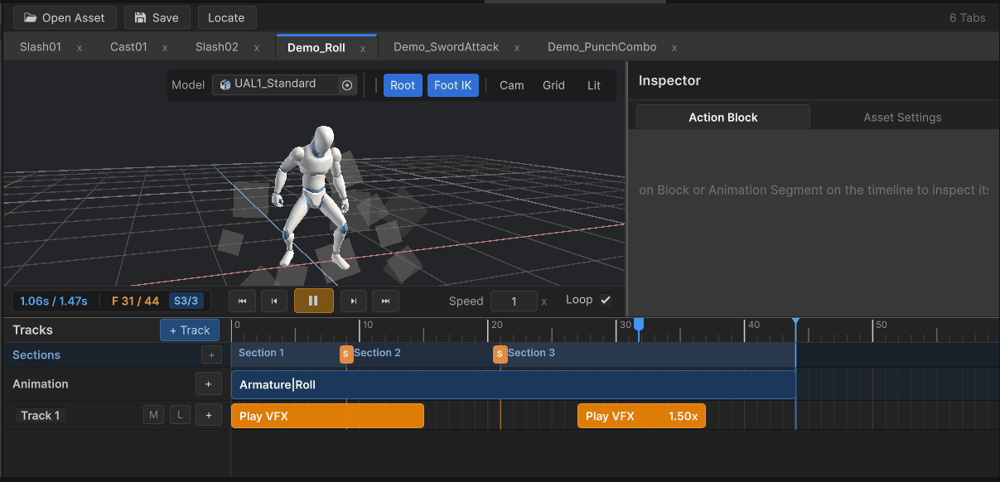
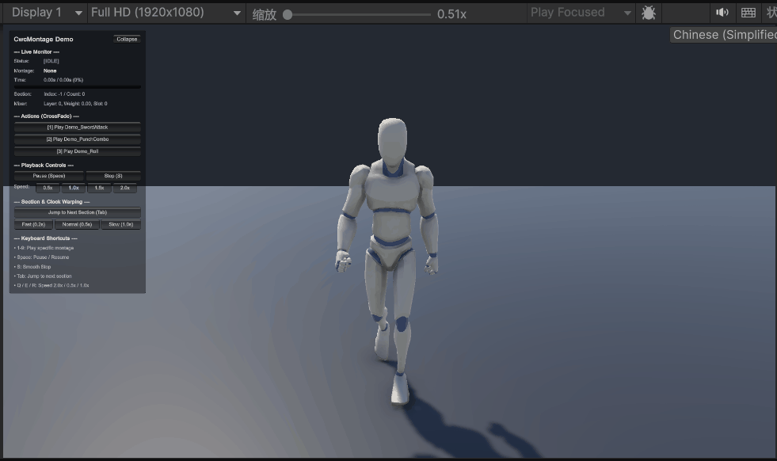

# CwcMontage - Unity Playables 动作蒙太奇系统

[](https://unity.com/)
[-blue.svg)](LICENSE)
[](https://github.com/CwcbbChao/CwcMontage/pulls)
[](https://cwcbbchao.github.io/CwcMontage/)

[English](README_EN.md) | **简体中文**

> **在线文档**：[https://cwcbbchao.github.io/CwcMontage/](https://cwcbbchao.github.io/CwcMontage/)  
> 包含完整上手教程、核心 API 手册与编辑器使用说明。

---

## 插件简介

`CwcMontage` 是为 Unity 动作游戏（ACT / ARPG / 动作射击等）开发的轻量动作蒙太奇系统。

它基于 Unity **Playables API** 构建，核心目标是**把动画表现和战斗玩法逻辑彻底分开**：
- 状态机或技能系统只需要决定“在什么时机播放哪个招式”。
- 动画片段拼接、过渡淡入淡出、特效与音效打点、按键蓄力后摇取消、以及根运动（Root Motion）提取，全部由蒙太奇系统统一处理。
- 不需要在 Animator Controller 状态机里连出密密麻麻、难以维护的网状过渡线。

---

## 效果演示

### 1. 蒙太奇时间轴编辑器 (Montage Editor)
支持时间轴拖拽预览、粒子特效随进度实时切片预览、多片段修剪与分段配置：



### 2. 运行时多轨混音与平滑过渡 (Runtime Showcase)
双插槽交叉淡入淡出（CrossFade）、动态调整分段时长与事件防漏触发：



---

## 仓库结构

- **`.github/`**：自动化工作流与文档构建脚本。
- **`docs/`**：VitePress 在线文档源码与图片资源。
- **`LICENSE`**：开源代码可用许可证（Cwc Tools Public License）。
- **`CwcMontage/`**：核心 Unity Package 产物目录（包含 `Runtime/`、`Editor/`、`Demo/`、离线文档 `Documentation/` 及 `package.json`）。将此文件夹直接复制进项目的 `Assets/` 即可直接使用。

---

## 核心特性

1. **动画表现与玩法解耦**  
   系统不绑定任何具体的战斗属性或数值逻辑。通过继承 `MontageActionBlockBase`，开发者可以自由扩展打点事件，比如播放音效、生成特效、顿帧、震屏或开启伤害判定盒。

2. **自带开箱即用的状态控制器 (`MontageSimpleAnimator<TState>`)**  
   不需要每次从零写角色动画驱动逻辑。只需定义一个状态枚举（如 Idle, Move, Attack, Hurt, Dead），继承 `MontageSimpleAnimator<TState>`，就能在 Inspector 里直接绑定蒙太奇或裸动画切片，支持优先级仲裁、持续状态循环与限时瞬态自愈。

3. **三轨并行独立分层混音 (Full Body / Upper Body / Additive)**  
   原生支持全身、上半身与叠加三条通道。满足边跑边打、移动施法，或在任何攻击动作中叠加受击抖动与开火后坐力的需求。

4. **上半身腰部朝向补偿 (Spine Decoupling)**  
   解决人形角色边跑边打时，上半身随着骨盆剧烈晃动导致瞄准歪斜的常见引擎痛点。运行时通过逆变换自动校正腰部局部朝向，普通 Humanoid 动作不用在 3D 建模软件里重修骨骼。

5. **动作分段与时长动态缩放 (Sections)**  
   一个招式可以打断点切成多个物理阶段（如前摇、判定、后摇）。如果策划在配置表里调整了招式帧数，代码里调用 `handle.SyncSectionDuration(...)` 即可直接拉伸或压缩对应阶段，无需美术重新切动画。

6. **事件打点成对触发保护**  
   时间轴上的动作块（ActionBlock）基于前后帧的时间跨度进行扫描。即使游戏掉帧或卡顿跨过了整个事件，系统也会按顺序成对触发 `OnEnter` 和 `OnExit`，彻底避免音效或特效由于漏帧卡在场景里不消失。

7. **统一的序列接口 (`IMontageSequence`) 与多种资产格式**  
   支持经典 `MontageSequenceSO`、现代包装容器 `MontageSequenceAsset`，也支持在代码里纯内存组装数据（`MontageSequenceData`），甚至可以直接传入普通 `AnimationClip` 进行零临时资产播放。配套提供一键迁移工具（`MontageMigrationUtility`）。

8. **内存与 GC 友好**  
   配置资产在运行期为只读，临时状态全部通过对象池进行复用；每个混合层预分配双插槽（Double-Buffered Slots）做过渡，播放动画时无需频繁增删 Playable 节点，杜绝运行期垃圾回收与卡顿。

9. **安全的播放控制句柄 (`MontageHandle`)**  
   播放方法返回轻量值类型句柄（16 字节 struct），内置代际检测。当动画播完或被顶替时句柄会自动失效，防止逻辑层持有悬空引用误操作。

10. **独立的 Root Motion 委托派发**  
    支持水平、垂直和旋转位移独立过滤，提取出的位移增量直接回调给实现 `IMontageRootMotionReceiver` 接口的移动组件，不强行接管你的物理或角色控制器。

---

## 快速上手

### 1. 播放招式并动态调整前中后摇时长

```csharp
using UnityEngine;
using Cwcbb.Tools.CwcMontage;

public class PlayerCombatController : MonoBehaviour
{
    [SerializeField] private MontageController _montageController;
    [SerializeField] private MontageSequenceAsset _attackMontage;

    public void PerformAttack(float windupDuration, float activeDuration, float recoveryDuration)
    {
        // 播放蒙太奇，获取轻量控制句柄
        MontageHandle handle = _montageController.Play(_attackMontage);

        if (handle.IsValid)
        {
            // 将策划配置表中的前摇、判定、后摇时长动态应用到分段
            handle.SyncSectionDuration(0, windupDuration);    // 第 0 段：前摇
            handle.SyncSectionDuration(1, activeDuration);    // 第 1 段：判定
            handle.SyncSectionDuration(2, recoveryDuration);  // 第 2 段：后摇
        }
    }
}
```

### 2. 使用 MontageSimpleAnimator 快速搭建角色状态动画

```csharp
using UnityEngine;
using Cwcbb.Tools.CwcMontage;

// 1. 定义你的角色业务状态
public enum PlayerState
{
    Idle = 0,
    Move = 10,
    Hurt = 50,
    Attack = 60,
    Dead = 100
}

// 2. 继承泛型基类，直接获得完整的状态优先级仲裁与调试面板
public class PlayerAnimator : MontageSimpleAnimator<PlayerState>
{
    // 配置角色的基础移动速度，用于根据当前实际移速自动缩放走跑动画
    protected override float BaseLocomotionSpeed => 5.0f;
}

// 3. 业务调用方式：
// 开启移动持续状态（传入当前移速）：
// playerAnimator.SetSustainedState(PlayerState.Move, true, currentSpeed);

// 受到攻击，触发 0.3 秒受击动作（到期自动恢复原状态）：
// playerAnimator.TriggerTimedState(PlayerState.Hurt, 0.3f);
```

### 3. 自定义时间轴动作块 (例如顿帧)

```csharp
using UnityEngine;
using Cwcbb.Tools.CwcMontage;

[MontageCategory("战斗")]
[MontageColor("#E74C3C")]
[MontageDisplayName("顿帧 (Hit Stop)")]
public class HitStopActionBlock : MontageActionBlockBase
{
    [SerializeField] private float _timeScale = 0.05f;

    public override void OnEnter(in MontageActionContext context)
    {
        base.OnEnter(context);
        Time.timeScale = _timeScale;
    }

    public override void OnExit(in MontageActionContext context)
    {
        base.OnExit(context);
        Time.timeScale = 1.0f;
    }
}
```

---

## 演示工程 (Demo)

插件内包含一套完整的战斗动作演示工程：
- **场景路径**：`CwcMontage/Demo/Scenes/MontageDemoScene.unity`。
- **开箱即用**：导入插件后直接双击该场景即可运行体验。
- **按键操作**：
  - **1 - 9**：切换三连斩、翻滚、连拳等不同招式。
  - **Space**：暂停 / 继续播放。
  - **Tab**：立刻跳转到下一个分段。
  - **Q / E / R**：慢放 (0.5x) / 正常 (1.0x) / 加速 (1.5x)。
  - 画面左上方配有实时 Playables 监控面板，直观观察混音槽权重与分段进度。
- **独立程序集**：Demo 拥有独立的 `.asmdef` 程序集，核心 `Runtime` 模块对 Demo 零反向依赖。

---

## 核心类与职责

| 类名 | 职责说明 |
| :--- | :--- |
| `MontageController` | 角色身上的核心组件，管理 PlayableGraph 混音图、通道权重、平滑过渡与 Root Motion 广播 |
| `MontageSimpleAnimator<TState>` | 状态动画控制器基类，基于枚举优先级仲裁持续与限时状态，自带调试监控 Inspector |
| `IMontageSequence` | 蒙太奇序列统一只读接口，解耦不同资产格式与底层播放器 |
| `MontageSequenceAsset` | 现代包装容器蒙太奇资产，适合模块化分发与制作 |
| `MontageSequenceSO` | 经典 ScriptableObject 蒙太奇配置资产 |
| `MontageSequenceData` | 纯 C# 内存数据模型，支持直接在代码里动态组装蒙太奇 |
| `MontageHandle` | 播放句柄（16 字节只读 struct），带代际有效性检测，用于动态调速、分段查询与打断 |
| `MontagePlayer` | 纯 C# 播放实例，执行时间轴推进、动作块事件扫描与切片采样 |
| `MontageActionBlockBase` | 自定义时间轴事件（特效、音效、顿帧、碰撞盒等）的扩展基类 |
| `MontageMigrationUtility` | 编辑器工具，提供旧版 `MontageSequenceSO` 与新版 `MontageSequenceAsset` 一键转换 |
| `MontageSpineDecoupleUtility` | 辅助采样工具，在奔跑攻击时负责腰部旋转实时解耦反解 |
| `IMontageRootMotionReceiver` | 根运动接收者接口，解耦外部物理移动组件 |

---

## 许可证说明

- 核心源码采用 [Cwc Tools Public License (Source-Available)](LICENSE) 许可：
  - **游戏作品发布（商业或免费游戏）**：允许在独立或商业游戏作品中免费集成、编译与发布，无需支付版税。
  - **工具二次分发限制**：禁止将本插件本体或修改版本作为独立开发工具、SDK、资产包或竞品插件进行二次分发或转售。
- 演示角色模型与动画由 [Quaternius](https://quaternius.com) 提供，遵循 **CC0 1.0 Universal (Public Domain Dedication)** 协议。
