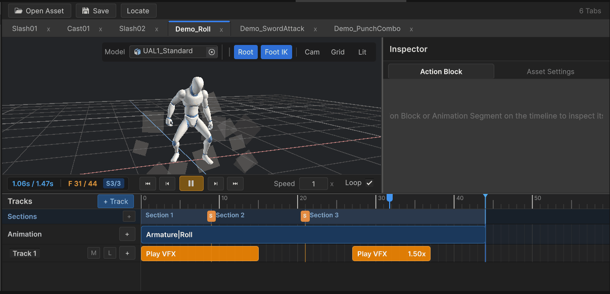
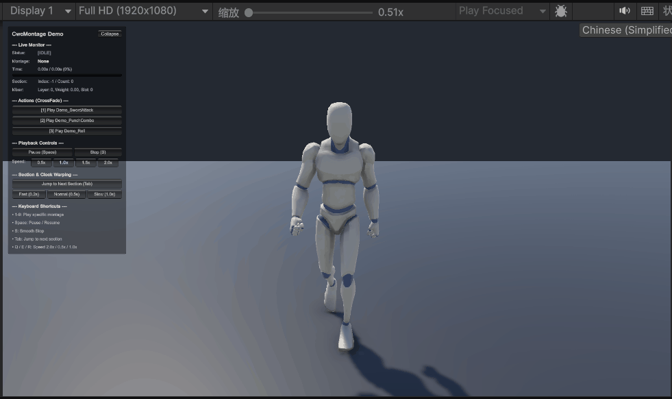

# CwcMontage - Playables Animation Montage System for Unity

[](https://unity.com/)
[-blue.svg)](LICENSE)
[](https://github.com/CwcbbChao/CwcMontage/pulls)
[](https://cwcbbchao.github.io/CwcMontage/)

**English** | [简体中文](README.md)

> **Online Documentation**: [https://cwcbbchao.github.io/CwcMontage/](https://cwcbbchao.github.io/CwcMontage/)  
> Includes getting started tutorials, complete API references, and editor guides.

---

## Overview

`CwcMontage` is a lightweight, responsive animation montage system for Unity action games (ACT, ARPG, action shooters, etc.).

Built natively on Unity's **Playables API**, its core objective is to **cleanly separate animation presentation from gameplay combat logic**:
- Your state machine or ability system simply decides *what action to play and when*.
- Clip trimming, crossfading, audio and visual effect events, section duration scaling, and Root Motion extraction are handled automatically by the montage system.
- No need to maintain tangled webs of transitions inside an Animator Controller graph.

---

## Visual Showcase

### 1. Interactive Montage Timeline Editor
Scrub the timeline freely with deterministic particle simulations, multi-clip trimming, and intuitive section setup:



### 2. Runtime Multi-Track Blending & Smooth Crossfading
Dual-slot crossfading, real-time section speed adjustment, and guaranteed paired event execution:



---

## Repository Structure

- **`.github/`**: Automation workflows and documentation deployment scripts.
- **`docs/`**: VitePress documentation source files and images.
- **`LICENSE`**: Source-available license for this repository (Cwc Tools Public License).
- **`CwcMontage/`**: Core Unity Package delivery directory (containing `Runtime/`, `Editor/`, `Demo/`, offline `Documentation/`, and `package.json`). Copy this folder directly into your project's `Assets/` to start using it.

---

## Key Features

1. **Decoupled Presentation & Combat Logic**  
   The core runtime does not hardcode gameplay or skill rules. By subclassing `MontageActionBlockBase`, you can easily trigger audio clips, VFX, hit-stops, camera shakes, or custom hitboxes.

2. **Out-of-the-Box State Controller (`MontageSimpleAnimator<TState>`)**  
   Save time by avoiding bespoke animation boilerplate for every character. Define an enum for your character states (e.g., Idle, Move, Attack, Hurt, Dead) and inherit `MontageSimpleAnimator<TState>` to bind montages or raw animation clips right inside the Inspector, with built-in priority arbitration, sustained state looping, and timed states.

3. **Multi-Layer Blending (Full Body / Upper Body / Additive)**  
   Supports Full Body, Upper Body, and Additive layers simultaneously with independent weights. Allows attacking while running, casting while moving, or layering hit flinches and gun recoil onto any base action.

4. **Upper-Body Spine Decoupling**  
   Fixes the classic engine issue where upper-body attacks tilt and sway with the pelvis during locomotion. Dynamically counter-rotates the spine at runtime so generic Humanoid animations aim straight without editing rigs in DCC tools.

5. **Action Sections & Dynamic Duration Warping**  
   Slice clips into stages like windup, active, and recovery using simple timestamps. If game designers tweak attack timings in data tables, adjust them at runtime using `handle.SyncSectionDuration(...)` without re-exporting animations.

6. **Guaranteed Paired Event Execution**  
   Timeline action blocks are evaluated based on delta intervals. Even under severe frame rate drops or spikes, `OnEnter` and `OnExit` execute strictly in pairs, preventing persistent lingering effects or audio loops.

7. **Unified Sequence Contract (`IMontageSequence`) & Multiple Formats**  
   Supports classic `MontageSequenceSO`, modern container `MontageSequenceAsset`, and purely in-memory data (`MontageSequenceData`). You can also play raw `AnimationClip` instances directly. Includes a one-click migration utility (`MontageMigrationUtility`).

8. **Memory & Performance Friendly**  
   Montage assets are read-only at runtime, with transient states reused through object pools. Each layer uses pre-allocated double-buffered slots for crossfades, avoiding runtime node reconstruction and eliminating GC allocations during playback.

9. **Safe Playback Handles (`MontageHandle`)**  
   Playback methods return lightweight 16-byte value-type handles with built-in generation checking. Expired or overridden handles invalidate automatically, eliminating accidental dangling operations.

10. **Delegated Root Motion**  
    Filter horizontal, vertical, and rotational displacement independently and delegate them through `IMontageRootMotionReceiver` without interfering with your existing physics or character controllers.

---

## Quick Start

### 1. Play a Montage and Adjust Section Durations

```csharp
using UnityEngine;
using Cwcbb.Tools.CwcMontage;

public class PlayerCombatController : MonoBehaviour
{
    [SerializeField] private MontageController _montageController;
    [SerializeField] private MontageSequenceAsset _attackMontage;

    public void PerformAttack(float windupDuration, float activeDuration, float recoveryDuration)
    {
        // Play the montage and get a lightweight handle
        MontageHandle handle = _montageController.Play(_attackMontage);

        if (handle.IsValid)
        {
            // Dynamically apply combat timing to sections
            handle.SyncSectionDuration(0, windupDuration);    // Section 0: Windup
            handle.SyncSectionDuration(1, activeDuration);    // Section 1: Active
            handle.SyncSectionDuration(2, recoveryDuration);  // Section 2: Recovery
        }
    }
}
```

### 2. Set Up Character Locomotion & States with MontageSimpleAnimator

```csharp
using UnityEngine;
using Cwcbb.Tools.CwcMontage;

// 1. Define your character states
public enum PlayerState
{
    Idle = 0,
    Move = 10,
    Hurt = 50,
    Attack = 60,
    Dead = 100
}

// 2. Inherit the generic class to get automated arbitration and an Inspector dashboard
public class PlayerAnimator : MontageSimpleAnimator<PlayerState>
{
    // Base speed used to scale locomotion animations automatically with current speed
    protected override float BaseLocomotionSpeed => 5.0f;
}

// 3. Call from your gameplay scripts:
// Enable continuous moving state (passing current velocity):
// playerAnimator.SetSustainedState(PlayerState.Move, true, currentSpeed);

// Trigger a 0.3-second hit reaction (automatically recovers when expired):
// playerAnimator.TriggerTimedState(PlayerState.Hurt, 0.3f);
```

### 3. Create a Custom Action Block (e.g., Hit Stop)

```csharp
using UnityEngine;
using Cwcbb.Tools.CwcMontage;

[MontageCategory("Combat")]
[MontageColor("#E74C3C")]
[MontageDisplayName("Hit Stop")]
public class HitStopActionBlock : MontageActionBlockBase
{
    [SerializeField] private float _timeScale = 0.05f;

    public override void OnEnter(in MontageActionContext context)
    {
        base.OnEnter(context);
        Time.timeScale = _timeScale;
    }

    public override void OnExit(in MontageActionContext context)
    {
        base.OnExit(context);
        Time.timeScale = 1.0f;
    }
}
```

---

## Interactive Demo

The package includes a complete combat demonstration scene:
- **Scene Location**: `CwcMontage/Demo/Scenes/MontageDemoScene.unity`.
- **Out of the Box**: Open and play the scene directly without unpacking.
- **Controls**:
  - **1 - 9**: Switch between attack combos, rolls, and punches.
  - **Space**: Pause / resume playback.
  - **Tab**: Skip immediately to the next section.
  - **Q / E / R**: Slow motion (0.5x) / Normal (1.0x) / Fast (1.5x).
  - The top-left HUD displays live Playables mixer weights and section progress.
- **Isolated Assembly**: The demo has its own `.asmdef` assembly and does not pollute core runtime code.

---

## Core Classes & Roles

| Class | Description |
| :--- | :--- |
| `MontageController` | Core component on the character managing PlayableGraph topology, layers, crossfades, and Root Motion |
| `MontageSimpleAnimator<TState>` | State animation controller base class with priority arbitration, inspector monitoring, and raw clip assembly |
| `IMontageSequence` | Unified read-only montage interface decoupling data assets from the underlying player |
| `MontageSequenceAsset` | Modern asset container designed for modular asset distribution and authoring |
| `MontageSequenceSO` | Classic ScriptableObject montage configuration asset |
| `MontageSequenceData` | In-memory data model for assembling montages purely in C# code |
| `MontageHandle` | 16-byte readonly struct handle with generational validity checking for safe playback control |
| `MontagePlayer` | Pure C# playback instance driving timeline sweep sampling and state stepping |
| `MontageActionBlockBase` | Base class for timeline events (audio, VFX, freeze-frames, hitboxes, etc.) |
| `MontageMigrationUtility` | Editor tool for seamless two-way migration between legacy SO and modern Asset formats |
| `MontageSpineDecoupleUtility` | Utility sampler performing dynamic spine counter-rotation during locomotion attacks |
| `IMontageRootMotionReceiver` | Receiver interface for delegated Root Motion deltas |

---

## License & Notices

- The core source code is released under the [Cwc Tools Public License (Source-Available)](LICENSE):
  - **End Products (Commercial & Free Games)**: Free to integrate, compile, and distribute within interactive games and applications without royalty fees.
  - **Tool Redistribution Restrictions**: You may not redistribute, resell, or sublicense the Software as a standalone development tool, plugin, SDK, or asset pack.
- Demo 3D humanoid character models and animations are provided by [Quaternius](https://quaternius.com) under the **CC0 1.0 Universal (Public Domain Dedication)** license.
